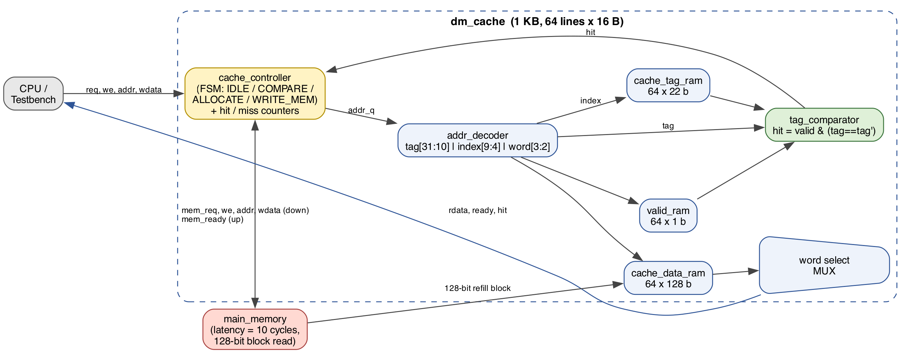
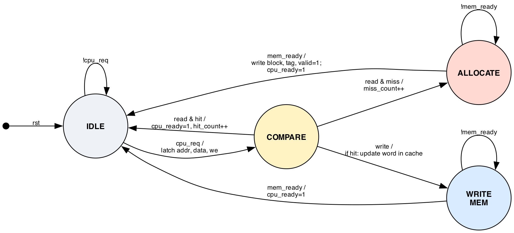
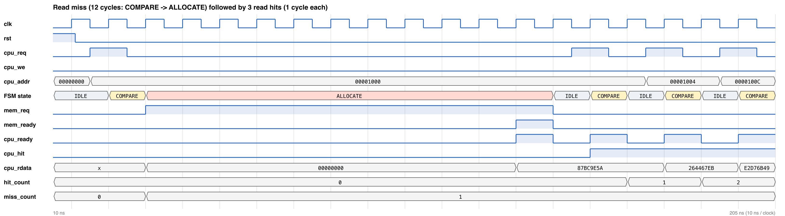

# Direct-Mapped Cache Controller (Verilog)

**CSA222 Modern Computer Architecture: Project 6** · Rishihood University / Newton School of Technology

| | |
|---|---|
| Report (Phase I, IEEE format) | [`docs/report/main.pdf`](docs/report/main.pdf) |
| Prototype demo video | **ADD LINK HERE** |
| Team | Tathagat Harsh (2401010477) · M S Thejas (2401010255) · Garv Verma (2401010168) · Parv Goyal (2401010322) · Vaibhav Rajput (2401010487) |

A 1 KB direct-mapped cache with 16-byte blocks and 32-bit addresses. It uses a write-through, no-write-allocate policy and is driven by a 4-state controller FSM. The design is verified by a self-checking testbench that compares **every** access against a golden reference model.



## Cache configuration

| Parameter | Value |
|---|---|
| Capacity / block / lines | 1 KB / 16 B (4 words) / 64 |
| Address split | tag `[31:10]` (22) · index `[9:4]` (6) · word `[3:2]` · byte `[1:0]` |
| Policy | write-through, no-write-allocate (no dirty bits) |
| Hit time / miss penalty | 1 cycle / 11 cycles (memory latency 10) |

## Controller FSM



| State | What happens |
|---|---|
| IDLE | wait for `cpu_req`, latch address / data / we |
| COMPARE | tag + valid check. Read hit → done in 1 cycle. Read miss → ALLOCATE. Write → WRITE_MEM (a write hit also updates the cache word) |
| ALLOCATE | fetch the 16-byte block from memory, write data + tag + valid, return the word |
| WRITE_MEM | write-through of the store to main memory |

## Results (Phase I simulation)

| Trace | Accesses | Hits | Hit rate | AMAT measured | AMAT = 1 + m×11 |
|---|---:|---:|---:|---:|---:|
| directed | 11 | 6 | 54.55 % | 5.89 | 5.89 |
| sequential (2 KB walk) | 512 | 384 | 75.00 % | 3.75 | 3.75 |
| repeated (512 B × 4) | 512 | 480 | 93.75 % | 1.69 | 1.69 |
| random (8 KB) | 512 | 53 | 10.35 % | 10.86 | 10.86 |
| conflict (same index) | 128 | 0 | 0.00 % | 12.00 | 12.00 |
| mixed read/write | 512 | 217 | 42.38 % | 7.19 | 7.19 |

**ALL CHECKS PASSED**: 2,187 accesses, 0 mismatches in hit/miss, data or hardware counters.



## Repository layout

```
rtl/                      synthesizable design
  addr_decoder.v          tag / index / word-select split
  cache_rams.v            cache_data_ram, cache_tag_ram, valid_ram
  tag_comparator.v        hit = valid & (stored_tag == tag)
  cache_controller.v      4-state FSM + hit/miss counters
  dm_cache.v              top level (connects everything)
  main_memory.v           behavioural DRAM model (simulation only)
tb/tb_dm_cache.v          self-checking testbench + reference model + 6 traces
sim/                      results.csv, trace_log.csv (every access), dm_cache.vcd, sim_output.txt
scripts/run_sim.sh        one command: compile, simulate, regenerate figures
scripts/vcd2svg.py        VCD -> waveform SVG (no dependencies)
docs/figures/             block diagram, FSM, waveforms (.dot/.svg/.png/.pdf)
docs/report/              IEEE report (main.tex + main.pdf)
video/VIDEO_SCRIPT.md     voiceover lines with timestamps (one part per member)
video/film/               animated 5-min film: index.html (seek(t)), render.mjs, audio.py
```

## How to run

```bash
brew install icarus-verilog graphviz librsvg   # macOS  (Ubuntu: apt install iverilog graphviz librsvg2-bin)
./scripts/run_sim.sh
gtkwave sim/dm_cache.vcd                        # optional: inspect waveforms
```

Rebuild the film: `cd video/film && npm i && node render.mjs full` → `video/film/out/dm_cache_film.mp4` (needs Node 22, ffmpeg, Python with numpy/librosa/soundfile).

Rebuild the report: `cd docs/report && tectonic main.tex` (or upload `main.tex` + `../figures` to Overleaf).

## Individual contributions

| Member | Owns |
|---|---|
| Tathagat Harsh | `cache_controller.v` (FSM + hit/miss counters), state diagram |
| M S Thejas | `cache_rams.v` (data / tag / valid RAMs), literature review |
| Garv Verma | architecture, `addr_decoder.v`, `tag_comparator.v`, block diagram |
| Parv Goyal | `main_memory.v`, `dm_cache.v` integration, `scripts/vcd2svg.py` waveforms |
| Vaibhav Rajput | `tb/tb_dm_cache.v` (reference model + traces), hit-rate / AMAT analysis |

## Phase II roadmap
- [ ] Vivado synthesis: LUT / FF / BRAM utilisation and Fmax
- [ ] 2-way set-associative LRU cache with the same interface, compared on identical traces
- [ ] Cache-size / block-size / latency sweeps
- [ ] Write buffer; write-through vs write-back memory-traffic comparison
- [ ] Final report: Results & Discussion, Conclusion

## References
Patterson & Hennessy, *Computer Organization and Design* (ch. 5) · Hennessy & Patterson, *Computer Architecture: A Quantitative Approach* · M. D. Hill, "A case for direct-mapped caches," *IEEE Computer*, 1988 (full list in the report).
